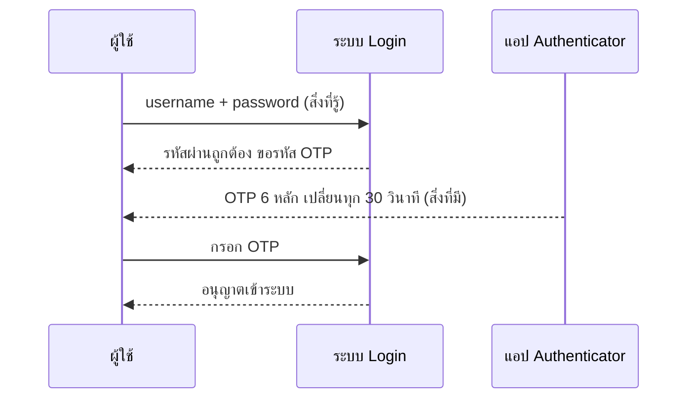

# สถาปัตยกรรม Zero Trust

ในอดีต การออกแบบความปลอดภัยของเครือข่ายมักยึดหลักการแบบ **"ปราสาทและคูเมือง (Castle-and-Moat)"** ซึ่งหมายความว่า หากใครสามารถผ่านระบบรักษาความปลอดภัยภายนอก (เช่น Firewall) เข้ามาสู่เครือข่ายภายในได้ ระบบก็จะเชื่อใจ (Trust) และอนุญาตให้เข้าถึงทรัพยากรต่างๆ ได้อย่างอิสระ แต่ในยุคที่เกิดการโจมตีซับซ้อนและการทำงานจากระยะไกล (Remote Work) แนวคิดนี้จึงไม่ปลอดภัยอีกต่อไป จึงเป็นที่มาของสถาปัตยกรรม **Zero Trust**

## หลักการพื้นฐานของ Zero Trust

Zero Trust ยึดปรัชญาที่ว่า **"Never Trust, Always Verify" (อย่าเชื่อใจใคร ต้องตรวจสอบเสมอ)** ไม่ว่าคำร้องขอจะมาจากภายนอกหรือภายในเครือข่าย ก็ถือว่าไม่น่าไว้วางใจจนกว่าจะได้รับการยืนยันตัวตนและสิทธิ์อย่างถูกต้อง

1. **การยืนยันตัวตนอย่างเข้มงวด (Explicit Verification):**
   ระบบต้องตรวจสอบผู้ใช้และอุปกรณ์ทุกครั้งที่ต้องการเข้าถึง โดยพิจารณาจากหลายปัจจัย (Signals) เช่น ตัวตนของผู้ใช้, ความปลอดภัยของอุปกรณ์ (Device Posture), ตำแหน่งที่ตั้ง (Location), และพฤติกรรมความเสี่ยง

2. **การให้สิทธิ์เท่าที่จำเป็น (Least Privilege Access):**
   ผู้ใช้และแอปพลิเคชันจะได้รับสิทธิ์เข้าถึงทรัพยากรเฉพาะเท่าที่จำเป็นต่อการทำงานในช่วงเวลานั้นๆ (Just-In-Time และ Just-Enough-Access) เท่านั้น เพื่อจำกัดความเสียหายหากบัญชีถูกแฮก

3. **สมมติฐานว่าระบบถูกเจาะแล้ว (Assume Breach):**
   ออกแบบระบบโดยคิดเผื่อว่าแฮกเกอร์อาจอยู่ในเครือข่ายแล้ว จึงต้องมีการแบ่งส่วนเครือข่ายย่อยๆ (**Micro-segmentation**) เพื่อจำกัดขอบเขตไม่ให้ภัยคุกคามลุกลาม (Lateral Movement) ไปยังส่วนอื่นได้ง่าย

## ส่วนประกอบของการนำ Zero Trust ไปใช้งาน (Implementation)

- **Identity and Access Management (IAM):** การใช้ Multi-Factor Authentication (MFA) และ Single Sign-On (SSO) เพื่อบริหารจัดการตัวตน
- **Endpoint Security:** อุปกรณ์ที่ใช้เชื่อมต่อต้องติดตั้งโปรแกรมป้องกันและมีการตรวจสอบสถานะอัปเดต (Compliance) อยู่เสมอ
- **Data Security:** ข้อมูลสำคัญจะต้องถูกเข้ารหัสทั้งขณะจัดเก็บ (At Rest) และขณะส่งผ่าน (In Transit) พร้อมทั้งจัดหมวดหมู่ข้อมูล
- **Continuous Monitoring:** มีระบบ Analytics หรือ AI (เช่น SIEM/SOAR) เพื่อเฝ้าระวังพฤติกรรมผิดปกติและตอบสนองต่อภัยคุกคามอัตโนมัติ

## การยืนยันตัวตนแบบหลายปัจจัย (MFA)

**Multi-Factor Authentication (MFA)** คือการยืนยันตัวตนโดยใช้ปัจจัย (factor) ตั้งแต่ **2 ประเภทขึ้นไปที่ต่างชนิดกัน** ซึ่งเป็นกลไกหลักของหลัก Explicit Verification ใน Zero Trust (ดู [[Zero-Trust Architecture]]) แนวทาง NIST SP 800-63B แบ่งปัจจัยเป็น 3 ประเภท

| ประเภทปัจจัย | ความหมาย | ตัวอย่าง |
|---|---|---|
| **Something you know** (สิ่งที่คุณรู้) | ความลับที่จำได้ | รหัสผ่าน, PIN |
| **Something you have** (สิ่งที่คุณมี) | อุปกรณ์ที่ครอบครอง | OTP ทาง SMS/โทรศัพท์, แอป Authenticator (TOTP), security key (USB/NFC) |
| **Something you are** (สิ่งที่คุณเป็น) | ลักษณะทางชีวภาพ (biometrics) | ลายนิ้วมือ, ใบหน้า |

> [!warning] รหัสผ่าน + PIN ไม่ใช่ MFA
> ทั้งสองเป็นปัจจัย "สิ่งที่คุณรู้" เหมือนกัน จึงยังเป็น single-factor ต้องผสม **ต่างประเภท** เท่านั้น

**ตัวอย่าง: รหัสผ่าน + OTP**



**ทำไม MFA จึงช่วยได้:** แม้รหัสผ่านจะรั่วจาก phishing หรือ data breach ผู้โจมตีก็ยังขาดปัจจัยที่สอง (เช่น โทรศัพท์ของเหยื่อ) จึงเข้าระบบไม่ได้ ช่วยลดการโจมตีแบบ credential stuffing และ password spraying ได้อย่างมาก

> [!note] Phishing-resistant MFA (FIDO2 / Passkeys)
> OTP และ push notification ยังถูกหลอกได้ เช่น เว็บปลอมขอให้กรอก OTP แล้วนำไปใช้ต่อทันที (real-time phishing) หรือการส่ง push ถี่ ๆ จนผู้ใช้กดยอมรับ (MFA fatigue) วิธีที่ **ต้านทาน phishing** คือการยืนยันด้วยกุญแจเข้ารหัสแบบ public-key ตามมาตรฐาน **FIDO2/WebAuthn** เช่น security key หรือ **passkey** บนโทรศัพท์/คอมพิวเตอร์ เพราะกุญแจผูกกับชื่อโดเมนของเว็บจริง เบราว์เซอร์จะไม่ใช้กุญแจนั้นกับเว็บปลอม NIST SP 800-63B-4 ให้ความสำคัญกับ phishing-resistant authenticator ในระดับความเชื่อมั่นสูง (ควรตรวจสอบรายละเอียดข้อกำหนดจากเอกสาร NIST ฉบับล่าสุด)

## ทบทวน: SQL Injection กับ Zero Trust

Zero Trust ไม่ได้หยุดแค่ "ใครเข้าระบบ" แต่รวมถึง **"ข้อมูลที่ส่งเข้ามาก็ห้ามเชื่อ"** — **SQL Injection** เกิดเมื่อแอปนำ input ของผู้ใช้ไปต่อเป็นคำสั่ง SQL โดยตรง ผู้โจมตีจึงแทรกคำสั่งเพิ่มเองได้ (ทบทวนใน [[Week 05 - Database & Data Management]])

```python
# ❌ ไม่ปลอดภัย: ต่อ string โดยตรง
# ถ้าผู้ใช้กรอก  ' OR '1'='1  เงื่อนไขจะเป็นจริงเสมอ
query = "SELECT * FROM users WHERE username = '" + username + "'"

# ✅ ปลอดภัย: parameterized query (placeholder) — ฐานข้อมูลถือ input เป็น "ข้อมูล" ไม่ใช่ "คำสั่ง"
cursor.execute("SELECT * FROM users WHERE username = %s", (username,))
```

*คำอธิบาย:* ใน parameterized query โครงสร้างคำสั่ง SQL ถูกส่งแยกจากค่า input ทำให้ input ที่มีเครื่องหมาย `'` หรือคำสั่ง SQL ไม่ถูกตีความเป็นคำสั่ง ควรใช้ร่วมกับ input validation และการให้บัญชีฐานข้อมูลของแอปมีสิทธิ์เท่าที่จำเป็น (least privilege) ซึ่งเป็นหลักเดียวกับ Zero Trust

<details><summary>ดูเฉลย: ใช้ "ลายนิ้วมือบนโทรศัพท์เพื่อปลดล็อก passkey" ถือว่ามีกี่ปัจจัย</summary>

**2 ปัจจัย** — สิ่งที่คุณมี (อุปกรณ์ที่เก็บ private key ของ passkey) และสิ่งที่คุณเป็น (ลายนิ้วมือที่ใช้ปลดล็อกกุญแจในเครื่อง) และยังเป็นแบบ phishing-resistant ด้วย
</details>

## สรุป

Zero Trust ไม่ใช่แค่ซอฟต์แวร์ตัวเดียว แต่เป็นกลยุทธ์ทางสถาปัตยกรรมที่องค์กรสมัยใหม่ต้องนำมาปรับใช้ เพื่อให้ระบบรอดพ้นจากการโจมตีขั้นสูงในปัจจุบัน
