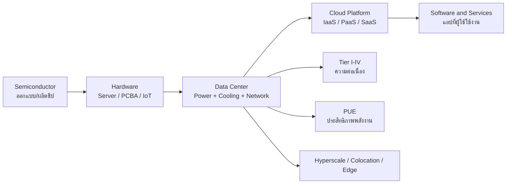

# ภาพรวมอุตสาหกรรมคอมพิวเตอร์และศูนย์ข้อมูล (Computer Industry & Data Center Landscape)

> **หมวดหมู่:** เนื้อหาเชิงลึกประกอบการเรียนรู้ (Deep Dive Learning Content)

## 🎯 สิ่งที่จะได้เรียนรู้
- อธิบาย value chain ของอุตสาหกรรมคอมพิวเตอร์ ตั้งแต่ semiconductor จนถึง software/services ได้
- ระบุองค์ประกอบหลักของศูนย์ข้อมูล (Data Center) ที่ควรสังเกตเมื่อไปดูงาน
- เปรียบเทียบ Uptime Institute Tier I–IV และอธิบายความหมายของ PUE
- แยกแยะ hyperscale, colocation และ edge data center พร้อมยกตัวอย่างบริบทประเทศไทย

## 📖 เนื้อหาและคำอธิบาย

### 1. ห่วงโซ่คุณค่าของอุตสาหกรรมคอมพิวเตอร์ (Value Chain)
ทุกบริการดิจิทัลที่เราใช้ เช่น LINE, Mobile Banking หรือ ChatGPT ตั้งอยู่บนหลายชั้นของอุตสาหกรรมที่ต่อกันเป็นทอด ๆ

| ชั้น (Layer) | ตัวอย่างกิจกรรม | ตัวอย่างงานของวิศวกรคอมพิวเตอร์ | เชื่อมกับสัปดาห์ |
|---|---|---|---|
| Semiconductor | ออกแบบชิป, ผลิตเวเฟอร์, ประกอบและทดสอบ (packaging/testing) | chip design, verification, test engineer | W03 |
| Hardware / Electronics | ผลิต PCB, PCBA, เซิร์ฟเวอร์, อุปกรณ์ IoT | embedded, hardware engineer | W02, W11 |
| Cloud / Data Center | ให้บริการพื้นที่, ไฟฟ้า, ระบบเย็น, compute/storage/network | DC operations, network/cloud engineer | W06, W07 |
| Software / Platform | OS, database, platform, AI model | software, data, ML engineer | W04, W05, W09 |
| Services / Applications | e-commerce, fintech, gov-tech, สมาร์ตฟาร์ม | DevOps/SRE, security, solution engineer | W12, W14 |

> [!note]
> ประเทศไทยมีบทบาทชัดในชั้น Hardware/Electronics (เช่น PCBA และชิ้นส่วนอิเล็กทรอนิกส์) และกำลังขยายตัวเร็วในชั้น Data Center/Cloud (ดูหัวข้อที่ 6)

### 2. องค์ประกอบของศูนย์ข้อมูล
ศูนย์ข้อมูลไม่ได้มีแค่ตู้เซิร์ฟเวอร์ แต่เป็น "โรงงานผลิตการประมวลผล" ที่ต้องมีระบบสนับสนุนครบ
- **IT load:** rack, server, storage, switch/router, GPU cluster
- **Power:** ไฟฟ้าจากการไฟฟ้า → transformer → UPS → PDU → rack และ generator สำรอง
- **Cooling:** CRAC/CRAH, chiller, hot/cold aisle containment และ [[Liquid Cooling]] สำหรับ rack AI ความหนาแน่นสูง
- **Network:** meet-me room, fiber จากหลายผู้ให้บริการ (carrier-neutral)
- **Security:** รั้ว, ยาม, CCTV, บัตร + biometric, mantrap — เทียบได้กับแนวคิด [[Zero-Trust Architecture]] ในโลกกายภาพ
- **Operations:** NOC/SOC, ระบบ monitoring (DCIM), ticket, change management

ตัวอย่างจริง: AWS อธิบายการป้องกันศูนย์ข้อมูลเป็น 4 layer คือ Perimeter (รั้ว ยาม กล้อง), Infrastructure (ไฟสำรอง HVAC ระบบดับเพลิง), Data (พื้นที่เดียวที่เก็บข้อมูลลูกค้า จำกัดสิทธิ์เข้มงวด) และ Environmental (เลือกทำเลลดความเสี่ยงน้ำท่วม/แผ่นดินไหว)

### 3. Uptime Institute Tier Classification
Tier เป็นระบบจำแนกความสามารถของโครงสร้างพื้นฐาน (ไฟฟ้า/ระบบเย็น) ในการรองรับการทำงานต่อเนื่อง แต่ละระดับรวมข้อกำหนดของระดับที่ต่ำกว่าไว้ด้วย

| Tier | ชื่อเรียก | ลักษณะสำคัญ | ผลต่อการบำรุงรักษา |
|---|---|---|---|
| I | Basic Capacity | มี UPS, ระบบเย็นเฉพาะ, generator | ต้องปิดระบบเพื่อซ่อมบำรุง |
| II | Redundant Capacity Components | มีอุปกรณ์สำรอง (UPS, chiller, ปั๊ม) | ถอดอุปกรณ์ได้ แต่เหตุขัดข้องไม่คาดคิดยังกระทบระบบ |
| III | Concurrently Maintainable | อุปกรณ์และเส้นทางจ่ายสำรอง | ซ่อมบำรุงชิ้นใดก็ได้โดยไม่หยุด IT |
| IV | Fault Tolerant | ระบบสำรองหลายชุดแยกอิสระทางกายภาพ | ความล้มเหลวจุดเดียวไม่กระทบ IT |

> [!tip]
> Uptime Institute ระบุว่า Tier ที่สูงกว่า "ไม่ได้ดีกว่าเสมอ" ต้องเลือกให้เหมาะกับความต้องการธุรกิจ นี่คือตัวอย่างการตัดสินใจเชิงวิศวกรรมแบบ trade-off ระหว่างความน่าเชื่อถือกับต้นทุน

### 4. PUE: ตัวชี้วัดประสิทธิภาพพลังงาน
[[PUE]] (Power Usage Effectiveness) เป็นตัวชี้วัดที่ The Green Grid พัฒนาและเผยแพร่ คำนวณจาก

`PUE = พลังงานทั้งหมดของศูนย์ข้อมูล / พลังงานที่อุปกรณ์ IT ใช้`

- PUE = 2.0 หมายถึงทุก 1 วัตต์ที่ใช้ประมวลผล ต้องใช้อีก 1 วัตต์กับระบบเย็นและการจ่ายไฟ
- ค่ายิ่งเข้าใกล้ 1.0 ยิ่งดี ตัวอย่าง: Google รายงานค่า PUE เฉลี่ยรายปีของศูนย์ข้อมูลทั่วโลกในปี 2025 เท่ากับ 1.09 (วัดต่อเนื่องแบบ trailing twelve-month รวมทุกฤดู)
- PUE ไม่ได้วัด "ความเขียว" ทั้งหมด เพราะไม่บอกแหล่งพลังงานหรือปริมาณน้ำที่ใช้

### 5. Hyperscale vs Colocation vs Edge

| ประเภท | เจ้าของ/ผู้ใช้ | ขนาดโดยทั่วไป | จุดเด่น | สิ่งที่ควรสังเกตเมื่อดูงาน |
|---|---|---|---|---|
| Hyperscale | ผู้ให้บริการคลาวด์รายใหญ่ (AWS, Google, Microsoft) | ใหญ่มาก | ระบบอัตโนมัติสูง ออกแบบฮาร์ดแวร์เอง | automation, PUE, custom hardware |
| Colocation | ผู้ให้เช่าพื้นที่/ไฟ/ระบบเย็นแก่หลายองค์กร | กลาง–ใหญ่ | carrier-neutral ลูกค้าเป็นเจ้าของเซิร์ฟเวอร์เอง | การแยกพื้นที่ลูกค้า (cage), SLA, Tier |
| Edge | ใกล้ผู้ใช้หรืออุปกรณ์ เช่น โรงงาน เสาสัญญาณ | เล็ก | latency ต่ำ ประมวลผลข้อมูล IoT ได้ทันที | การดูแลระยะไกล ความทนทานต่อสภาพแวดล้อม |

ดูเพิ่มเติม [[Edge Computing]]

### 6. ศูนย์ข้อมูลในประเทศไทย (ข้อเท็จจริงที่ตรวจสอบได้)
- สำนักงานคณะกรรมการส่งเสริมการลงทุน (BOI) แถลง (ข่าวที่ 92/2568, 24 ก.ค. 2025) ว่าครึ่งแรกของปี 2025 ธุรกิจ data center มีคำขอรับส่งเสริมรวม 521.2 พันล้านบาท จาก 28 โครงการ และกล่าวถึง hyperscaler อย่าง Amazon Web Services และ Google ที่ประกาศแผนขยายในไทยและภูมิภาค
- BOI แถลง (17 มี.ค. 2025) อนุมัติ 3 โครงการ data center/cloud มูลค่ารวม 90.9 พันล้านบาท IT load รวมเกือบ 350 MW ตั้งอยู่ในระยอง ชลบุรี และกรุงเทพฯ
- นัยต่อผู้เรียน: งานด้าน DC operations, network, cloud และระบบไฟฟ้า/พลังงานมีแนวโน้มเติบโตโดยเฉพาะพื้นที่ EEC แต่ต้องติดตามข้อมูลล่าสุดจากแหล่งทางการ เพราะ "คำขอรับส่งเสริม" ไม่เท่ากับ "การลงทุนที่เกิดขึ้นจริง"

## 🧩 ตัวอย่างประกอบ / กรณีศึกษา

**Data Center Tour Observation Checklist (เชื่อมกับสัปดาห์เรียน)**

| # | สิ่งที่ต้องสังเกต/ถาม | หลักฐานที่ควรบันทึก | เชื่อมสัปดาห์ |
|---|---|---|---|
| 1 | ศูนย์นี้ออกแบบตาม Tier ใด ได้รับรองหรือไม่ | คำตอบวิทยากร/เอกสารที่เปิดเผยได้ | W07 |
| 2 | วัด PUE อย่างไร มีเป้าหมายลดอย่างไร | วิธีวัด (ไม่จำเป็นต้องได้ตัวเลขจริง) | W07 |
| 3 | ใช้ระบบเย็นแบบใด (air, containment, liquid) | ลักษณะ aisle, ท่อน้ำ, CDU | W07 |
| 4 | การเชื่อมต่อเครือข่าย มีผู้ให้บริการกี่ราย | meet-me room, redundancy | W06 |
| 5 | ขั้นตอนเข้าพื้นที่ (badge, biometric, mantrap, escort) | ลำดับขั้นการยืนยันตัวตน | W12 |
| 6 | ระบบ monitoring/automation และทีมปฏิบัติการ | dashboard, ticket, shift | W14 |
| 7 | มีงาน AI/GPU หรือไม่ ความหนาแน่น rack เปลี่ยนไปอย่างไร | คำอธิบายเชิงคุณภาพ | W09, W10 |
| 8 | ตำแหน่งงานที่พบและทักษะที่ต้องการ | ชื่อบทบาท + ทักษะ | W15 |

ตัวอย่างการบันทึก: *"W07 — วิทยากรอธิบายว่าระบบไฟมีสองเส้นทางจ่ายแยกกัน ทำให้ซ่อม UPS ได้โดยไม่หยุดเซิร์ฟเวอร์ ซึ่งสอดคล้องกับนิยาม Tier III (Concurrently Maintainable)"*

## 🗺️ แผนภาพสรุป

## ⚠️ ข้อควรระวัง / ความเข้าใจผิดที่พบบ่อย
- **"Tier IV ดีที่สุดเสมอ"** — ไม่ถูกต้อง ต้องพิจารณาความต้องการธุรกิจและต้นทุน
- **"PUE ต่ำ = เป็นมิตรต่อสิ่งแวดล้อมเสมอ"** — ไม่ครบ ต้องดูแหล่งพลังงานและการใช้น้ำประกอบ
- **ความลับของสถานที่:** ผู้ให้บริการหลายรายไม่เปิดเผยที่ตั้งหรือผังภายใน (AWS ระบุว่าเก็บที่ตั้งศูนย์ข้อมูลเป็นความลับ) ห้ามเผยแพร่ภาพผังอาคาร ป้ายชื่อ rack หรือหน้าจอ dashboard
- **การถ่ายภาพ:** ถ่ายเฉพาะจุดที่ได้รับอนุญาต ห้ามถ่ายบัตรพนักงาน ใบหน้า หรือหน้าจอที่มีข้อมูลลูกค้า ภาพที่ระบุตัวบุคคลได้ถือเป็นข้อมูลส่วนบุคคลตาม [[PDPA]]
- **ตัวเลขการลงทุน:** อย่าสับสน "คำขอรับส่งเสริม" กับ "เงินลงทุนจริง" และอ้างอิงแหล่งทางการทุกครั้ง

## 🔗 เชื่อมโยงกับรายวิชา
- [[Week 15 - Academic Visits & Computer Industry Tour]]
- [[Week 07 - Data Center & Cloud Infrastructure]] · [[PUE]] · [[Liquid Cooling]] · [[Edge Computing]]
- [[Week 06 - Computer Networks & Internet]]
- [[Week 12 - Cybersecurity & Trust Architecture]] · [[Zero-Trust Architecture]] · [[CIA Triad]]
- [[Week 14 - Applied System Engineering & DevOps]]
- [[PDPA]] · [[การวัดและประเมินผล]]

## ❓ คำถามทบทวน / กิจกรรมสะท้อนคิด
1. อธิบายความแตกต่างระหว่าง Tier II และ Tier III ด้วยตัวอย่างการซ่อม UPS

ดูแนวคำตอบ

Tier II มีอุปกรณ์สำรองแต่เส้นทางจ่ายไฟยังไม่สำรอง การซ่อมบางจุดจึงอาจต้องหยุดระบบ ส่วน Tier III มีทั้งอุปกรณ์และเส้นทางจ่ายสำรอง จึงซ่อม UPS ได้โดยระบบ IT ยังทำงานต่อ (Concurrently Maintainable)

2. ศูนย์ข้อมูลใช้พลังงานรวม 1,500 kWh โดยอุปกรณ์ IT ใช้ 1,000 kWh ค่า PUE เท่าไร และหมายความว่าอย่างไร

ดูแนวคำตอบ

PUE = 1,500 / 1,000 = 1.5 หมายถึงทุก 1 kWh ที่ใช้ประมวลผล มีพลังงานส่วนเกิน 0.5 kWh สำหรับระบบเย็น การจ่ายไฟ และแสงสว่าง

3. ระบบสมาร์ตฟาร์มที่ต้องสั่งปั๊มน้ำทันทีเมื่อเซนเซอร์แจ้งเตือน ควรประมวลผลที่ hyperscale, colocation หรือ edge เพราะเหตุใด

ดูแนวคำตอบ

Edge เพราะอยู่ใกล้อุปกรณ์ ลด latency และยังทำงานได้แม้อินเทอร์เน็ตขัดข้อง ส่วนการเก็บข้อมูลระยะยาวหรือ train model ส่งขึ้น cloud (hyperscale) ได้ เป็นสถาปัตยกรรมแบบผสม

4. ทำไมผู้ให้บริการคลาวด์จึงไม่เปิดเผยที่ตั้งศูนย์ข้อมูลอย่างละเอียด เชื่อมกับ CIA Triad อย่างไร

ดูแนวคำตอบ

ลดความเสี่ยงการโจมตีทางกายภาพที่กระทบ Availability และการเข้าถึงข้อมูลโดยมิชอบที่กระทบ Confidentiality/Integrity เป็นการป้องกันชั้น Perimeter ก่อนถึงชั้นข้อมูล

5. สะท้อนคิด: คุณสนใจชั้นใดใน value chain มากที่สุด และทักษะจากรายวิชาสัปดาห์ใดที่เกี่ยวข้อง

ดูแนวคำตอบ

คำตอบเปิด ควรระบุชั้น (เช่น Cloud/Data Center) ยกบทบาทงาน (เช่น network engineer) เชื่อมสัปดาห์ (W06, W07, W12) และเขียนแผนพัฒนาตนเองอย่างน้อย 1 ข้อ

## 📚 แหล่งอ้างอิง
1. Uptime Institute. *Tier Classification System*. https://uptimeinstitute.com/tiers
2. The Green Grid. (2014). *PUE: A Comprehensive Examination of the Metric*. https://www.thegreengrid.org/en/resources/library-and-tools/20-PUE%3A-A-Comprehensive-Examination-of-the-Metric
3. Google. *Data Centers: Power efficiency*. https://datacenters.google/efficiency/
4. Amazon Web Services. *AWS Data Centers — Data Center Layers*. https://aws.amazon.com/compliance/data-center/data-centers/
5. Thailand Board of Investment. (2025, July 24). *Press Release No. 92/2568: Thailand First-Half Investment Applications Hit USD 32.5 billion on Soaring Data Center Sector*. https://osos.boi.go.th/article_attach/PR92_2568EN.pdf
6. Thailand Board of Investment. (2025, March 17). *Thailand BOI Approves 200 Billion Baht Investments in Rail and Digital Infrastructure Projects*. https://osos.boi.go.th/EN/news/2187/Thailand-BOI-Approves-200-Billion-Baht-Investments-in-Rail-a/
