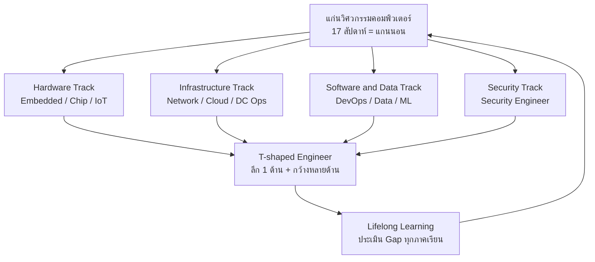

# บทบาทอาชีพและทักษะวิศวกรคอมพิวเตอร์ยุคใหม่ (Career Roles & T-shaped Skills)

> **หมวดหมู่:** เนื้อหาเชิงลึกประกอบการเรียนรู้ (Deep Dive Learning Content)

## 🎯 สิ่งที่จะได้เรียนรู้
- อธิบายบทบาทอาชีพหลักของบัณฑิตวิศวกรรมคอมพิวเตอร์ หน้าที่ และทักษะที่ต้องใช้
- เชื่อมแต่ละบทบาทกับหัวข้อที่เรียนในรายวิชา EN-001-019
- อธิบายแนวคิด T-shaped skills และ lifelong learning
- ประเมินช่องว่างทักษะ (skills gap) ของตนเองและวางแผนพัฒนา

## 📖 เนื้อหาและคำอธิบาย

### 1. วิศวกรคอมพิวเตอร์อยู่ตรงไหน
หลักสูตร CE2016 ของ ACM/IEEE อธิบายวิศวกรรมคอมพิวเตอร์ว่าเป็นสาขาที่ผสาน hardware และ software เข้าด้วยกัน ตั้งแต่วงจรดิจิทัลจนถึงระบบเครือข่ายและระบบฝังตัว ทำให้บัณฑิต CE มีเส้นทางอาชีพกว้างกว่าสาขาที่เน้นด้านเดียว

### 2. บทบาทอาชีพหลัก

| บทบาท | หน้าที่หลัก | ทักษะสำคัญ | สัปดาห์ที่เกี่ยวข้อง |
|---|---|---|---|
| Embedded Engineer | พัฒนา firmware บนไมโครคอนโทรลเลอร์ ควบคุมฮาร์ดแวร์ | C/C++, digital logic, RTOS, อ่าน datasheet | W02, W03, W11 |
| IoT Engineer | ออกแบบระบบเซนเซอร์–เครือข่าย–cloud ครบวงจร | MQTT, wireless, edge, dashboard | W06, W11 |
| Hardware / Chip Design Engineer | ออกแบบ/ทดสอบวงจรดิจิทัลและชิป | HDL (Verilog/VHDL), computer architecture, RISC-V | W03 |
| Network Engineer | ออกแบบ ติดตั้ง ดูแลเครือข่ายองค์กร | TCP/IP, routing/switching, troubleshooting | W06 |
| Cloud Engineer | ออกแบบและดูแลโครงสร้างพื้นฐานบนคลาวด์ | virtualization, container, IaaS/PaaS, cost | W07 |
| DevOps / SRE | สร้าง CI/CD, automation, ดูแล reliability | Linux, Git, Docker/Kubernetes, monitoring | W14 |
| Data Engineer | สร้าง data pipeline และคลังข้อมูล | SQL, ETL, data modeling, Python | W05 |
| ML Engineer | นำ model ไปใช้งานจริงและดูแล (MLOps) | Python, ML fundamentals, [[MLOps]] | W09, W10, W14 |
| Security Engineer | ป้องกัน ตรวจจับ ตอบสนองภัยคุกคาม | network security, IAM, [[Zero-Trust Architecture]] | W12 |
| Data Center Operations Engineer | ดูแลระบบไฟ ระบบเย็น อุปกรณ์ IT ในศูนย์ข้อมูล | Tier, [[PUE]], hardware, incident handling | W07 |

> [!note]
> ชื่อตำแหน่งแตกต่างกันในแต่ละองค์กร ควรอ่าน "หน้าที่" ในประกาศรับสมัครมากกว่ายึดชื่อตำแหน่ง ตัวอย่างเช่น NICE Framework ของ NIST สำหรับงาน cybersecurity ระบุชัดว่า Work Role ไม่เท่ากับชื่อตำแหน่งงาน แต่เป็นกลุ่มของงาน (Task) ที่ต้องใช้ความรู้ (Knowledge) และทักษะ (Skill) ที่กำหนด

### 3. แนวโน้มทักษะจากรายงานระดับโลก
*Future of Jobs Report 2025* ของ World Economic Forum (สำรวจนายจ้างมากกว่า 1,000 รายทั่วโลก) คาดการณ์ว่าระหว่างปี 2025–2030 จะมีงานใหม่เกิดขึ้น 170 ล้านตำแหน่ง และงานถูกแทนที่ 92 ล้านตำแหน่ง (เพิ่มสุทธิ 78 ล้าน) จากหลายแรงขับ เช่น เทคโนโลยี การเปลี่ยนผ่านสีเขียว และประชากรศาสตร์ ทักษะด้านเทคโนโลยีที่เติบโตเร็ว ได้แก่ AI and big data, networks and cybersecurity และ technological literacy ควบคู่กับทักษะด้านมนุษย์ เช่น creative thinking, resilience และ curiosity and lifelong learning

> [!warning]
> ตัวเลขเหล่านี้เป็น "การคาดการณ์" จากแบบสำรวจนายจ้างระดับโลก ไม่ใช่ข้อมูลตลาดแรงงานไทยโดยตรง เมื่ออ้างในรายงานต้องระบุบริบทนี้

### 4. T-shaped Skills
- **แกนตั้ง (ลึก):** ความเชี่ยวชาญ 1 ด้าน เช่น embedded systems หรือ cloud
- **แกนนอน (กว้าง):** ความเข้าใจพื้นฐานหลายด้าน + soft skills เช่น เครือข่าย ฐานข้อมูล security การสื่อสาร การทำงานเป็นทีม
- รายวิชานี้สร้าง "แกนนอน" ครบ 17 สัปดาห์ ส่วนแกนตั้งจะพัฒนาในรายวิชาเฉพาะและโครงงานในปีถัดไป

| รูปแบบ | ลักษณะ | ข้อดี | ความเสี่ยง |
|---|---|---|---|
| I-shaped | ลึกด้านเดียว | เชี่ยวชาญเฉพาะทาง | สื่อสารข้ามทีมยาก ปรับตัวช้าเมื่อเทคโนโลยีเปลี่ยน |
| Generalist | กว้างแต่ตื้น | ปรับตัวง่าย | ขาดจุดเด่นในการแข่งขัน |
| T-shaped | ลึก 1 + กว้างหลายด้าน | ทำงานข้ามสายงานได้ และมีความเชี่ยวชาญ | ต้องวางแผนการเรียนรู้ต่อเนื่อง |

### 5. Lifelong Learning
เทคโนโลยีเปลี่ยนเร็ว (ดูตัวอย่าง Generative AI ใน [[Week 10 - Generative AI & Modern Robotics]]) วิศวกรจึงต้องมีนิสัยเรียนรู้ เช่น อ่านเอกสารทางการ (official docs) ทำโครงงานส่วนตัว เข้าชุมชนเทคโนโลยี และเรียนหลักสูตรออนไลน์ ซึ่งสอดคล้องกับ ACM Code of Ethics ข้อ 2.2 ที่ให้ผู้ประกอบวิชาชีพคอมพิวเตอร์รักษามาตรฐานสูงด้านความสามารถทางวิชาชีพ การปฏิบัติตน และจริยธรรม (Maintain high standards of professional competence, conduct, and ethical practice)

## 🧩 ตัวอย่างประกอบ / กรณีศึกษา

**แบบประเมินช่องว่างทักษะตนเอง (Skills-gap Self-assessment)**

ตัวอย่าง: นักศึกษาสนใจบทบาท *Cloud Engineer* ให้คะแนน 1 (เริ่มต้น) – 5 (ทำได้ดี)

| ทักษะที่บทบาทต้องการ | ระดับปัจจุบัน | ระดับเป้าหมาย (สิ้นปี 2) | Gap | แผนพัฒนา | หลักฐาน |
|---|---|---|---|---|---|
| Linux command line | 2 | 4 | 2 | ฝึกใช้ Linux ทุกสัปดาห์ ทำ lab container ซ้ำ | repo บันทึกคำสั่ง |
| Networking (TCP/IP) | 2 | 4 | 2 | ทบทวน W06 ทำ lab จำลองเครือข่าย | รายงาน lab |
| Container (Docker) | 1 | 3 | 2 | deploy Mini-Project Web ด้วย Docker | Dockerfile บน GitHub |
| Security พื้นฐาน | 2 | 3 | 1 | ศึกษา IAM และ Zero Trust | สรุป 1 หน้า |
| การสื่อสาร/นำเสนอ | 3 | 4 | 1 | นำเสนอ Week 16 และขอ feedback | สไลด์ + feedback |

**วิธีใช้:** (1) เลือก 1–2 บทบาทจากตาราง (2) อ่านประกาศรับสมัครจริง 3 ประกาศ สกัดทักษะที่ซ้ำกัน (3) ให้คะแนนตนเองอย่างซื่อตรง (4) เลือก gap ที่ใหญ่ที่สุด 2 ข้อมาทำแผน (5) ทบทวนทุกภาคการศึกษา

**กรณีศึกษาสั้น:** ในการดูงานศูนย์ข้อมูล นักศึกษาพบว่าทีมงานประกอบด้วยวิศวกรไฟฟ้า วิศวกรเครือข่าย ทีม security และผู้ดูแลระบบ monitoring ทั้งหมดต้องสื่อสารกันเมื่อเกิดเหตุขัดข้อง — สะท้อนว่าแม้จะเชี่ยวชาญคนละด้าน แต่ทุกคนต้องมี "แกนนอน" ที่เข้าใจงานของกันและกัน

## 🗺️ แผนภาพสรุป

## ⚠️ ข้อควรระวัง / ความเข้าใจผิดที่พบบ่อย
- **"ต้องเลือกสายตั้งแต่ปี 1"** — ไม่จำเป็น ปี 1 ควรสำรวจให้กว้าง แล้วค่อยเจาะลึกเมื่อพบความสนใจจริง
- **"สายที่ฮิตที่สุดคือสายที่ดีที่สุด"** — ควรพิจารณาความถนัด ความสนใจ และความต้องการของตลาดร่วมกัน
- **ข้อมูลเงินเดือน:** ตัวเลขในโซเชียลมักไม่มีแหล่งอ้างอิงที่ตรวจสอบได้ หากใช้ในรายงานต้องอ้างแหล่งที่น่าเชื่อถือและระบุปี/บริบท
- **ระหว่างดูงาน:** ถามวิทยากรเรื่องบทบาทและทักษะได้ แต่ไม่ควรถามเงินเดือนรายบุคคล โครงสร้างองค์กรที่เป็นความลับ หรือข้อมูลลูกค้า ห้ามบันทึกเสียง/ภาพวิทยากรโดยไม่ได้รับอนุญาต (คำนึงถึง [[PDPA]])
- **ใบรับรอง (certificate) ไม่ใช่ทุกอย่าง:** นายจ้างมักดูผลงานจริง (portfolio) ควบคู่กัน

## 🔗 เชื่อมโยงกับรายวิชา
- [[Week 15 - Academic Visits & Computer Industry Tour]]
- [[Week 03 - Digital Logic & Modern Processors]] · [[RISC-V]]
- [[Week 06 - Computer Networks & Internet]] · [[Week 07 - Data Center & Cloud Infrastructure]] · [[PUE]] · [[Liquid Cooling]]
- [[Week 09 - AI & Machine Learning Foundations]] · [[MLOps]]
- [[Week 11 - Embedded Systems & IoT]] · [[Edge Computing]]
- [[Week 12 - Cybersecurity & Trust Architecture]] · [[Zero-Trust Architecture]]
- [[Week 14 - Applied System Engineering & DevOps]]
- [[PDPA]] · [[การวัดและประเมินผล]]

## ❓ คำถามทบทวน / กิจกรรมสะท้อนคิด
1. เปรียบเทียบหน้าที่ของ Cloud Engineer และ DevOps/SRE ว่าซ้อนทับและต่างกันอย่างไร

ดูแนวคำตอบ

ซ้อนทับ: ทั้งคู่ทำงานกับโครงสร้างพื้นฐานและ automation ต่างกัน: Cloud Engineer เน้นออกแบบ/ดูแลทรัพยากรคลาวด์ (network, compute, storage, cost) ส่วน DevOps/SRE เน้นกระบวนการส่งมอบซอฟต์แวร์ (CI/CD) และความน่าเชื่อถือของบริการ (monitoring, incident response)

2. อธิบาย T-shaped skills โดยยกตัวอย่างตนเอง

ดูแนวคำตอบ

เช่น แกนตั้ง = IoT (ทำ Mini-Project IoT ได้ลึก) แกนนอน = เข้าใจเครือข่าย ฐานข้อมูล security พื้นฐาน และนำเสนอได้ดี ควรระบุแผนพัฒนาทั้งสองแกน

3. บทบาท Security Engineer เชื่อมกับเนื้อหาสัปดาห์ใดบ้าง อย่างน้อย 3 สัปดาห์

ดูแนวคำตอบ

W06 (เครือข่าย/โปรโตคอล), W07 (ความปลอดภัยศูนย์ข้อมูลและคลาวด์), W12 (CIA Triad, Zero Trust), W13 (จริยธรรม/กฎหมาย), W14 (DevSecOps ใน pipeline)

4. ทำแบบประเมิน skills gap สำหรับบทบาทที่สนใจ อย่างน้อย 5 ทักษะ พร้อมแผนพัฒนา

ดูแนวคำตอบ

ใช้ตารางตัวอย่างข้างต้น ทักษะควรสกัดจากประกาศรับสมัครจริง แผนต้องเฉพาะเจาะจง วัดผลได้ และมีหลักฐาน (repo, รายงาน, สไลด์)

5. สะท้อนคิด: บทบาทใดที่พบระหว่างดูงานแล้วคุณไม่เคยรู้จักมาก่อน

ดูแนวคำตอบ

คำตอบเปิด ควรอธิบายหน้าที่ของบทบาทนั้นจากสิ่งที่วิทยากรเล่า ทักษะที่ต้องใช้ และความเชื่อมโยงกับรายวิชา

## 📚 แหล่งอ้างอิง
1. ACM/IEEE-CS Joint Task Force. (2016). *Computer Engineering Curricula 2016 (CE2016)*. https://www.acm.org/binaries/content/assets/education/ce2016-final-report.pdf
2. World Economic Forum. (2025, January 7). *Future of Jobs Report 2025*. https://reports.weforum.org/docs/WEF_Future_of_Jobs_Report_2025.pdf
3. World Economic Forum. (2025). *Future of Jobs Report 2025: 78 Million New Job Opportunities by 2030 but Urgent Upskilling Needed to Prepare Workforces* [Press release]. https://www.weforum.org/media/future-of-jobs-report-2025-78-million-new-job-opportunities-by-2030-but-urgent-upskilling-needed-to-prepare-workforces/
4. CISA / NIST. *NICE Workforce Framework for Cybersecurity (NICE Framework)*. https://niccs.cisa.gov/workforce-development/nice-framework
5. ACM. (2018). *ACM Code of Ethics and Professional Conduct*. https://www.acm.org/code-of-ethics
